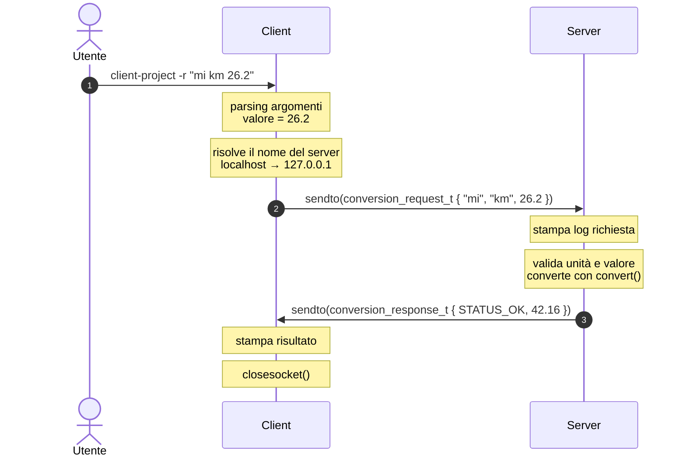

# Secondo Esonero di Laboratorio - Reti di Calcolatori (Informatica) a.a. '26-27

## Obiettivo

Migrare a **UDP** l'applicazione client/server del primo esonero, in cui il server è un **convertitore di unità di misura**. Il punto di partenza è la soluzione TCP consegnata dalla vostra coppia: protocollo applicativo, conversione e formato dei messaggi restano gli stessi; cambiano il trasporto (datagrammi UDP) e alcuni requisiti del client:

- `-s` accetta un **nome** di host (es. `localhost`) oltre a un indirizzo IP, e l'output del client riporta il nome e l'indirizzo IP del server;
- il client attende la risposta per al massimo `TIMEOUT_SEC` secondi.

La specifica è data da tre elementi, da leggere insieme:

1. il file [`protocol.h`](client-project/src/protocol.h) (già fornito, **non modificare** le definizioni);
2. il diagramma di sequenza;
3. la tabella degli esempi, che fa fede per il formato di input e output.

## 1. Protocollo

Le strutture `conversion_request_t` e `conversion_response_t`, i codici di stato e le costanti sono definiti in [`protocol.h`](client-project/src/protocol.h). Client e server si scambiano queste strutture rispettando quattro regole:

- ogni messaggio viaggia in **un solo datagramma UDP**: la richiesta è un datagramma di `sizeof(conversion_request_t)` byte, la risposta un datagramma di `sizeof(conversion_response_t)` byte;
- il valore è un `float`: nel campo `value` viaggiano i suoi 32 bit (vedi lezione *Costruzione di messaggi*);
- i campi `uint32_t` vanno convertiti in **network byte order** prima dell'invio e riconvertiti dopo la ricezione;
- in caso di errore (`status != STATUS_OK`) il server invia `value = 0`.

## 2. Diagramma di sequenza



Il server risponde a una richiesta alla volta e non termina mai. I datagrammi di dimensione diversa da `sizeof(conversion_request_t)` vengono ignorati: nessuna risposta e nessuna riga di log.

## 3. Conversione (server)

Il server conosce le unità della tabella. Per ogni unità, la colonna **1 unit =** dice a quanti **metri** (`LENGTH`) o **chilogrammi** (`MASS`) corrisponde:

| Symbol | Quantity | 1 unit = |
|---|---|---|
| `m` | `LENGTH` | 1 m |
| `km` | `LENGTH` | 1000 m |
| `ft` | `LENGTH` | 0.3048 m |
| `yd` | `LENGTH` | 0.9144 m |
| `mi` | `LENGTH` | 1609.344 m |
| `g` | `MASS` | 0.001 kg |
| `kg` | `MASS` | 1 kg |
| `oz` | `MASS` | 0.028349523 kg |
| `lb` | `MASS` | 0.45359237 kg |

Ricevuta una richiesta `FROM TO valore`, il server esegue **in quest'ordine** i controlli:

1. cerca `FROM` e `TO` nella tabella (maiuscole e minuscole contano: `KM` non esiste). Se uno dei due manca → `STATUS_INVALID_UNIT`;
2. se le due unità sono di grandezze diverse (es. `km` e `kg`) → `STATUS_INCOMPATIBLE_UNITS`;
3. se `valore` non è compreso tra 0 (escluso) e `MAX_VALUE` (incluso) → `STATUS_INVALID_VALUE`;
4. altrimenti risponde `STATUS_OK` con il valore convertito:

   **risultato = valore × fattore(FROM) / fattore(TO)**

   Esempio: 26.2 mi → km = 26.2 × 1609.344 / 1000 = 42.16 km

Per la tabella e il calcolo usate **esattamente** questo codice:

<!-- codice-imposto -->
```c
typedef enum { LENGTH, MASS } quantity_t;

typedef struct {
    const char *symbol;
    quantity_t quantity;
    double factor;    // 1 unit = factor metres (LENGTH) or kilograms (MASS)
} unit_t;

static const unit_t UNITS[] = {
    {"m",  LENGTH, 1.0},    {"km", LENGTH, 1000.0}, {"ft", LENGTH, 0.3048},
    {"yd", LENGTH, 0.9144}, {"mi", LENGTH, 1609.344},
    {"g",  MASS,   0.001},  {"kg", MASS,   1.0},    {"oz", MASS,   0.028349523},
    {"lb", MASS,   0.45359237},
};

/*
 * Converts a value from one unit to another of the same quantity.
 * Example: 26.2 mi -> km is convert(26.2f, 1609.344, 1000.0) = 42.16 km
 */
float convert(float value, double factor_from, double factor_to) {
    return (float)(value * factor_from / factor_to);  // double math: same result on every machine
}
```

## 4. Interfaccia da riga di comando

```
client-project [-s server] [-p port] -r "FROM TO valore"
server-project [-p port]
```

| Opzione | Default |
|---|---|
| `-s` | `DEFAULT_SERVER_NAME` |
| `-p` | `SERVER_PORT` |

Il valore di `-s` può essere un nome di host o un indirizzo IP: il client lo risolve con `gethostbyname()`, che accetta entrambi. Nell'output, il **nome** è la stringa passata con `-s` (o `DEFAULT_SERVER_NAME`), l'**ip** è l'indirizzo risolto. Se la risoluzione fallisce, il client stampa un errore ed esce con codice di uscita diverso da 0.

## 5. Timeout (client)

Con UDP il client non ha modo di sapere se il server è in ascolto: senza un timeout, `recvfrom()` resterebbe bloccata per sempre. Subito dopo aver creato il socket, impostate il timeout di ricezione usando **esattamente** questo codice:

<!-- codice-imposto -->
```c
#if defined WIN32
	DWORD timeout = TIMEOUT_SEC * 1000;
#else
	struct timeval timeout = { TIMEOUT_SEC, 0 };
#endif
	setsockopt(my_socket, SOL_SOCKET, SO_RCVTIMEO, (const char *) &timeout, sizeof(timeout));
```

Se `recvfrom()` fallisce (timeout scaduto o errore) o il datagramma ricevuto non ha la dimensione di `conversion_response_t`, il client stampa un errore ed esce con codice di uscita diverso da 0.
## 6. Esempi

Server avviato con `server-project`, client avviato con `client-project -r ...` (quindi `-s` vale `localhost`). La colonna **Log server** riporta l'output del server per la stessa richiesta.

| `-r` | Output client | Log server |
|---|---|---|
| `"mi km 26.2"` | `Ricevuto risultato dal server localhost (ip 127.0.0.1). 26.20 mi = 42.16 km` | `Richiesta 'mi km 26.20' dal client ip 127.0.0.1` |
| `"km mi 10"` | `Ricevuto risultato dal server localhost (ip 127.0.0.1). 10.00 km = 6.21 mi` | `Richiesta 'km mi 10.00' dal client ip 127.0.0.1` |
| `"m ft 100"` | `Ricevuto risultato dal server localhost (ip 127.0.0.1). 100.00 m = 328.08 ft` | `Richiesta 'm ft 100.00' dal client ip 127.0.0.1` |
| `"ft m 1"` | `Ricevuto risultato dal server localhost (ip 127.0.0.1). 1.00 ft = 0.30 m` | `Richiesta 'ft m 1.00' dal client ip 127.0.0.1` |
| `"kg lb 70.5"` | `Ricevuto risultato dal server localhost (ip 127.0.0.1). 70.50 kg = 155.43 lb` | `Richiesta 'kg lb 70.50' dal client ip 127.0.0.1` |
| `"lb oz 2.5"` | `Ricevuto risultato dal server localhost (ip 127.0.0.1). 2.50 lb = 40.00 oz` | `Richiesta 'lb oz 2.50' dal client ip 127.0.0.1` |
| `"yd yd 12.34"` | `Ricevuto risultato dal server localhost (ip 127.0.0.1). 12.34 yd = 12.34 yd` | `Richiesta 'yd yd 12.34' dal client ip 127.0.0.1` |
| `"mi ft 1000"` | `Ricevuto risultato dal server localhost (ip 127.0.0.1). 1000.00 mi = 5280000.00 ft` | `Richiesta 'mi ft 1000.00' dal client ip 127.0.0.1` |
| `"KM mi 1"` | `Ricevuto risultato dal server localhost (ip 127.0.0.1). Simbolo non supportato` | `Richiesta 'KM mi 1.00' dal client ip 127.0.0.1` |
| `"m xyz 0"` | `Ricevuto risultato dal server localhost (ip 127.0.0.1). Simbolo non supportato` | `Richiesta 'm xyz 0.00' dal client ip 127.0.0.1` |
| `"km kg 0"` | `Ricevuto risultato dal server localhost (ip 127.0.0.1). Grandezze incompatibili` | `Richiesta 'km kg 0.00' dal client ip 127.0.0.1` |
| `"m km -5"` | `Ricevuto risultato dal server localhost (ip 127.0.0.1). Valore non valido` | `Richiesta 'm km -5.00' dal client ip 127.0.0.1` |
| `"g kg 0"` | `Ricevuto risultato dal server localhost (ip 127.0.0.1). Valore non valido` | `Richiesta 'g kg 0.00' dal client ip 127.0.0.1` |
| `"lb kg 1000.01"` | `Ricevuto risultato dal server localhost (ip 127.0.0.1). Valore non valido` | `Richiesta 'lb kg 1000.01' dal client ip 127.0.0.1` |

Se `-r` manca o il suo argomento non è nel formato `"FROM TO valore"` (simbolo più lungo di 3 caratteri, valore non numerico, campi mancanti o in più), il client **non contatta il server**, stampa

```
Uso: client-project [-s server] [-p port] -r "FROM TO valore"
```

ed esce con codice di uscita diverso da 0.

Con `-s 127.0.0.1` la prima riga diventa `Ricevuto risultato dal server 127.0.0.1 (ip 127.0.0.1). 26.20 mi = 42.16 km`.

> [!WARNING]
> L'output deve corrispondere **carattere per carattere** a quello degli esempi: lingua italiana, spazi, punteggiatura, due cifre decimali, nessun messaggio aggiuntivo.
> Se il nome del server non si risolve, la risposta non arriva entro `TIMEOUT_SEC` secondi o non è valida (dimensione errata, codice di stato sconosciuto), il client stampa un errore ed esce con codice di uscita diverso da 0; in tutti gli altri casi esce con codice 0.

## 7. Requisiti

1. Il codice compila ed esegue su **Windows, Linux e macOS**, nei progetti Eclipse CDT forniti.
2. Il client è compatibile con il server di riferimento e il server con il client di riferimento, usati per la correzione.
3. Il codice è privo di buffer overflow, memory leak e comportamento indefinito.

## Consegna

- **Scadenza**: _DA DEFINIRE_
- **Form di prenotazione / consegna**: [link](#) _DA DEFINIRE_ (Ctrl/Cmd-clic per aprire in una nuova scheda)
- **Formato**: link al repository GitHub **privato**, con l'utente `correttore-lab-reti` aggiunto come collaboratore in lettura (vedi README)
- **Risultati**: [link](#) _DA DEFINIRE_ (Ctrl/Cmd-clic per aprire in una nuova scheda)
- **Note**:
   - Una sola consegna per coppia
   - Non è necessario ricompilare il form di consegna dopo aggiornamenti al repository
   - La pagina dei risultati si aggiorna tre volte al giorno, alle 9, alle 15 e alle 21

_Ver. 0.1.0_
